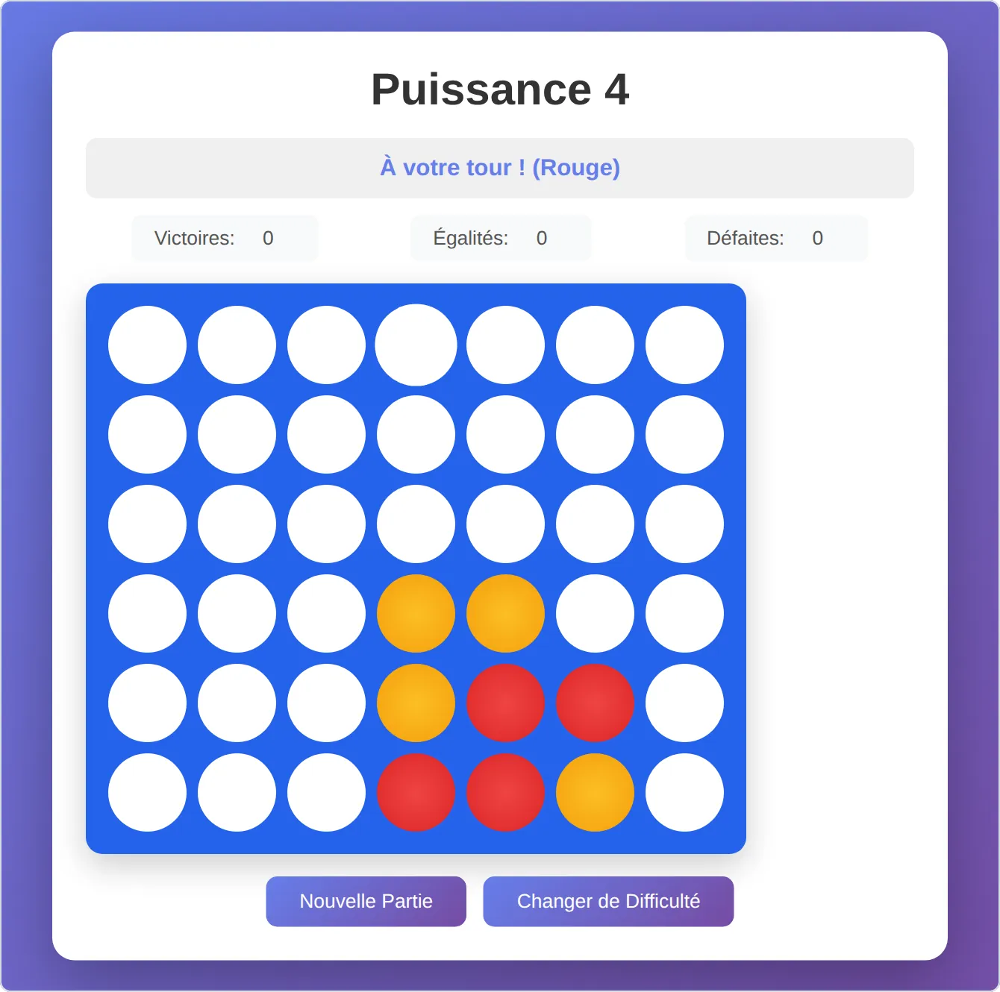
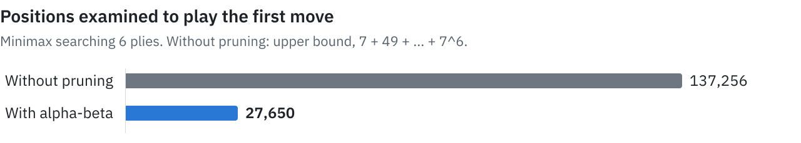

# Puissance 4

Connect Four in the browser, against two computer opponents, built with Node.js and Express. The interface is in French.



## Levels

| Level in the interface | Method |
|---|---|
| Intermédiaire | Takes a winning move, blocks yours, then plays strategically 7 times out of 10 and at random otherwise |
| Imbattable | Minimax with alpha-beta pruning, searching 6 plies ahead |

## Results

Measured by playing the game engine against itself, 100 games per pairing, alternating who starts:

| Minimax against | Wins | Draws | Losses |
|---|--:|--:|--:|
| Intermédiaire | **97** | 0 | 3 |
| A random player | **100** | 0 | 0 |

The minimax plays in 55 ms per move (median against Intermédiaire). Despite its name, Imbattable ("unbeatable") can lose, because its search depth is limited.

<picture>
  <source media="(prefers-color-scheme: dark)" srcset=".github/assets/pruning-dark.svg">
  
</picture>

## Getting started

Requires Node.js.

```bash
npm install
node server.js
```

Then open <http://localhost:3000>. Set the `PORT` variable to use another port.

## How it works

| File | Role |
|---|---|
| `game-engine.js` | Rules, win detection and both computer opponents |
| `server.js` | Express server: serves `public/` and exposes `POST /api/game/new` and `POST /api/game/:gameId/move` |
| `public/` | Interface in plain JavaScript, HTML and CSS |

`server.js` also holds Socket.IO handlers for a phone voting room. No interface uses them yet.

## License

MIT, as declared in `package.json`.
